# Piloto técnico de la cabecera del perfil

Rama de prueba. No es el perfil: aquí se mide si GitHub pinta lo que necesita el README nuevo.
Las medidas y la conclusión están en [piloto/INFORME.md](piloto/INFORME.md).

## Experimento 1: fuentes embebidas

Space Grotesk 600, Space Mono 700 e Inter 400 dentro del SVG, en base64.

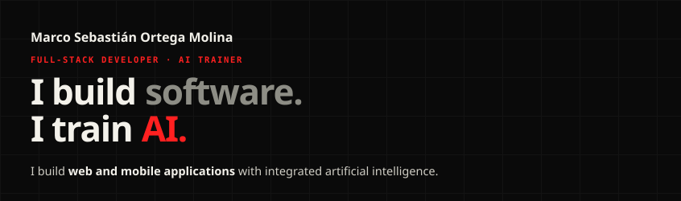

Control: el mismo SVG pidiendo fuentes que no existen. Tiene que verse distinto.

Controles por fuente: a cada uno le falta una sola de las tres fuentes.

## Experimento 2: pestañas como imágenes pegadas

Seis pestañas, cada una con su enlace, y debajo el cuerpo de la ventana. Los enlaces son provisionales.

### 2a. En línea, sin espacios entre etiquetas

<a href="https://www.kairomx.tech/cv/#home">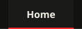</a><a href="https://www.kairomx.tech/cv/#projects">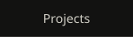</a><a href="https://www.kairomx.tech/cv/#stack">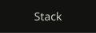</a><a href="https://www.kairomx.tech/cv/#experience">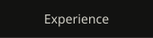</a><a href="https://www.kairomx.tech/cv/#about">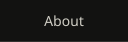</a><a href="https://www.kairomx.tech/cv/#contact">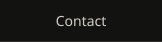</a> 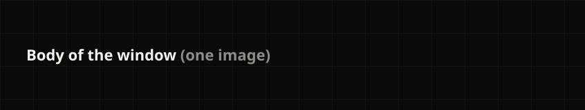

### 2b. Con align="left"

### 2c. En una tabla

<table>
<tr><td></td><td></td><td></td><td></td><td></td><td></td></tr>
<tr><td colspan="6"></td></tr>
</table>

### 2d. En línea, con align="top"

 

### 2e. En línea, con align="top" y pestañas de 76 de alto (barra de título encima)

<a href="https://www.kairomx.tech/cv/#home">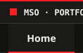</a><a href="https://www.kairomx.tech/cv/#projects">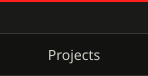</a><a href="https://www.kairomx.tech/cv/#stack">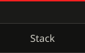</a><a href="https://www.kairomx.tech/cv/#experience">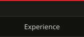</a><a href="https://www.kairomx.tech/cv/#about">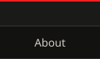</a><a href="https://www.kairomx.tech/cv/#contact">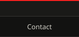</a> 

### 2f. Como 2e, cada pieza en un picture con su variante de tema, y fila de 84 de alto

<a href="https://www.kairomx.tech/cv/#home"><picture><source media="(prefers-color-scheme: dark)" srcset="piloto/assets/exp2-f-oscuro1-v3.svg">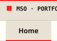</picture></a><a href="https://www.kairomx.tech/cv/#projects"><picture><source media="(prefers-color-scheme: dark)" srcset="piloto/assets/exp2-f-oscuro2-v3.svg">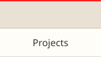</picture></a><a href="https://www.kairomx.tech/cv/#stack"><picture><source media="(prefers-color-scheme: dark)" srcset="piloto/assets/exp2-f-oscuro3-v3.svg">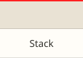</picture></a><a href="https://www.kairomx.tech/cv/#experience"><picture><source media="(prefers-color-scheme: dark)" srcset="piloto/assets/exp2-f-oscuro4-v3.svg">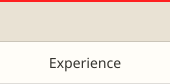</picture></a><a href="https://www.kairomx.tech/cv/#about"><picture><source media="(prefers-color-scheme: dark)" srcset="piloto/assets/exp2-f-oscuro5-v3.svg">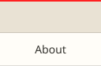</picture></a><a href="https://www.kairomx.tech/cv/#contact"><picture><source media="(prefers-color-scheme: dark)" srcset="piloto/assets/exp2-f-oscuro6-v3.svg">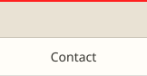</picture></a> <picture><source media="(prefers-color-scheme: dark)" srcset="piloto/assets/exp2-f-cuerpo-oscuro-v3.svg">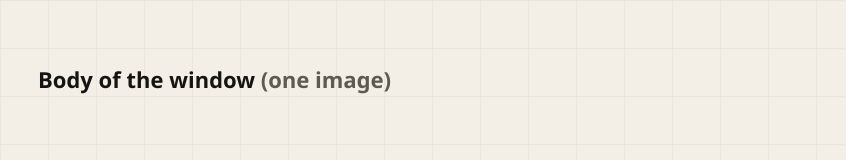</picture>

## Experimento 3: tema claro y oscuro

<picture>
<source media="(prefers-color-scheme: dark)" srcset="piloto/assets/exp3-oscuro-v1.svg">
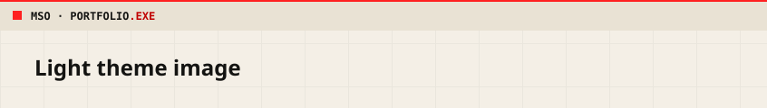
</picture>

## Experimento 4: avatar animado

Entra armándose con cuadritos, parpadea y mira a los lados. Un solo picture con cuatro fuentes:
tema oscuro o claro, con o sin «reducir movimiento» (la versión quieta).

<picture>
<source media="(prefers-color-scheme: dark) and (prefers-reduced-motion: reduce)" srcset="piloto/assets/exp4-avatar-oscuro-quieto-v2.svg">
<source media="(prefers-color-scheme: dark)" srcset="piloto/assets/exp4-avatar-oscuro-v2.svg">
<source media="(prefers-reduced-motion: reduce)" srcset="piloto/assets/exp4-avatar-claro-quieto-v2.svg">
</picture>
