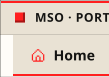
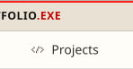
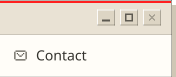
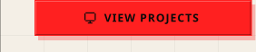
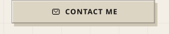

<!-- Generated by generador/generar.mjs from datos/perfil.en.json. Do not edit by hand. -->

<a href="https://www.kairomx.tech/cv/index.html?lang=en#inicio"><picture><source media="(max-width: 471px) and (prefers-color-scheme: dark)" srcset="assets/tab-home-mob-dark-32cb1bf4.svg"><source media="(max-width: 471px)" srcset="assets/tab-home-mob-light-249a7778.svg"><source media="(max-width: 1211px) and (prefers-color-scheme: dark)" srcset="assets/tab-home-tab-dark-f8c3d502.svg"><source media="(max-width: 1211px)" srcset="assets/tab-home-tab-light-afdffdfb.svg"><source media="(prefers-color-scheme: dark)" srcset="assets/tab-home-desk-dark-47198505.svg"></picture></a><a href="https://www.kairomx.tech/cv/index.html?lang=en#proyectos"><picture><source media="(max-width: 471px) and (prefers-color-scheme: dark)" srcset="assets/tab-projects-mob-dark-f856a45a.svg"><source media="(max-width: 471px)" srcset="assets/tab-projects-mob-light-05f28edb.svg"><source media="(max-width: 1211px) and (prefers-color-scheme: dark)" srcset="assets/tab-projects-tab-dark-04df9161.svg"><source media="(max-width: 1211px)" srcset="assets/tab-projects-tab-light-7916f662.svg"><source media="(prefers-color-scheme: dark)" srcset="assets/tab-projects-desk-dark-8fb0775b.svg"></picture></a><a href="https://www.kairomx.tech/cv/index.html?lang=en#stack"><picture><source media="(max-width: 471px) and (prefers-color-scheme: dark)" srcset="assets/tab-stack-mob-dark-cb65f715.svg"><source media="(max-width: 471px)" srcset="assets/tab-stack-mob-light-aa30c0cf.svg"><source media="(max-width: 1211px) and (prefers-color-scheme: dark)" srcset="assets/tab-stack-tab-dark-023ade3b.svg"><source media="(max-width: 1211px)" srcset="assets/tab-stack-tab-light-20f3022a.svg"><source media="(prefers-color-scheme: dark)" srcset="assets/tab-stack-desk-dark-9a88505e.svg"></picture></a><a href="https://www.kairomx.tech/cv/index.html?lang=en#entrenamiento-ia"><picture><source media="(max-width: 471px) and (prefers-color-scheme: dark)" srcset="assets/tab-experience-mob-dark-2cf9ef05.svg"><source media="(max-width: 471px)" srcset="assets/tab-experience-mob-light-73bbf664.svg"><source media="(max-width: 1211px) and (prefers-color-scheme: dark)" srcset="assets/tab-experience-tab-dark-1ad1133f.svg"><source media="(max-width: 1211px)" srcset="assets/tab-experience-tab-light-56f7f047.svg"><source media="(prefers-color-scheme: dark)" srcset="assets/tab-experience-desk-dark-1f6faac6.svg"></picture></a><a href="https://www.kairomx.tech/cv/index.html?lang=en#sobre-mi"><picture><source media="(max-width: 471px) and (prefers-color-scheme: dark)" srcset="assets/tab-about-mob-dark-841c1f59.svg"><source media="(max-width: 471px)" srcset="assets/tab-about-mob-light-c5d177cf.svg"><source media="(max-width: 1211px) and (prefers-color-scheme: dark)" srcset="assets/tab-about-tab-dark-8e3b95ed.svg"><source media="(max-width: 1211px)" srcset="assets/tab-about-tab-light-0ac6016b.svg"><source media="(prefers-color-scheme: dark)" srcset="assets/tab-about-desk-dark-bc271e2a.svg"></picture></a><a href="https://www.kairomx.tech/cv/index.html?lang=en#contacto"><picture><source media="(max-width: 471px) and (prefers-color-scheme: dark)" srcset="assets/tab-contact-mob-dark-86f863f3.svg"><source media="(max-width: 471px)" srcset="assets/tab-contact-mob-light-64c099d6.svg"><source media="(max-width: 1211px) and (prefers-color-scheme: dark)" srcset="assets/tab-contact-tab-dark-9b6c1d69.svg"><source media="(max-width: 1211px)" srcset="assets/tab-contact-tab-light-3d357cc5.svg"><source media="(prefers-color-scheme: dark)" srcset="assets/tab-contact-desk-dark-61fe9890.svg"></picture></a> <a href="https://www.kairomx.tech/cv/index.html?lang=en"><picture><source media="(max-width: 471px) and (prefers-color-scheme: dark) and (prefers-reduced-motion: reduce)" srcset="assets/hero-mob-dark-still-ec235459.svg"><source media="(max-width: 471px) and (prefers-color-scheme: dark)" srcset="assets/hero-mob-dark-d098da50.svg"><source media="(max-width: 471px) and (prefers-reduced-motion: reduce)" srcset="assets/hero-mob-light-still-9a342a25.svg"><source media="(max-width: 471px)" srcset="assets/hero-mob-light-c007ff62.svg"><source media="(max-width: 1211px) and (prefers-color-scheme: dark) and (prefers-reduced-motion: reduce)" srcset="assets/hero-tab-dark-still-d1c6ad5a.svg"><source media="(max-width: 1211px) and (prefers-color-scheme: dark)" srcset="assets/hero-tab-dark-6922ef29.svg"><source media="(max-width: 1211px) and (prefers-reduced-motion: reduce)" srcset="assets/hero-tab-light-still-6b48ef7c.svg"><source media="(max-width: 1211px)" srcset="assets/hero-tab-light-b442d539.svg"><source media="(prefers-color-scheme: dark) and (prefers-reduced-motion: reduce)" srcset="assets/hero-desk-dark-still-839c05d8.svg"><source media="(prefers-color-scheme: dark)" srcset="assets/hero-desk-dark-1ed02830.svg"><source media="(prefers-reduced-motion: reduce)" srcset="assets/hero-desk-light-still-b04b11e2.svg"></picture></a> <a href="https://www.kairomx.tech/cv/index.html?lang=en#proyectos"><picture><source media="(max-width: 471px) and (prefers-color-scheme: dark)" srcset="assets/btn-projects-mob-dark-fd7c5889.svg"><source media="(max-width: 471px)" srcset="assets/btn-projects-mob-light-c9300c2c.svg"><source media="(max-width: 1211px) and (prefers-color-scheme: dark)" srcset="assets/btn-projects-tab-dark-018a9aac.svg"><source media="(max-width: 1211px)" srcset="assets/btn-projects-tab-light-f467e48d.svg"><source media="(prefers-color-scheme: dark)" srcset="assets/btn-projects-desk-dark-65d63ba5.svg"></picture></a><a href="https://www.kairomx.tech/cv/index.html?lang=en#contacto"><picture><source media="(max-width: 471px) and (prefers-color-scheme: dark)" srcset="assets/btn-contact-mob-dark-9b9bed05.svg"><source media="(max-width: 471px)" srcset="assets/btn-contact-mob-light-e63e6ef8.svg"><source media="(max-width: 1211px) and (prefers-color-scheme: dark)" srcset="assets/btn-contact-tab-dark-4a00d582.svg"><source media="(max-width: 1211px)" srcset="assets/btn-contact-tab-light-45c58978.svg"><source media="(prefers-color-scheme: dark)" srcset="assets/btn-contact-desk-dark-96644cd5.svg"></picture></a><a href="https://www.kairomx.tech/cv/pdf/cv-en.pdf"><picture><source media="(max-width: 471px) and (prefers-color-scheme: dark)" srcset="assets/btn-cv-mob-dark-bf3152aa.svg"><source media="(max-width: 471px)" srcset="assets/btn-cv-mob-light-757613e5.svg"><source media="(max-width: 1211px) and (prefers-color-scheme: dark)" srcset="assets/btn-cv-tab-dark-5e79a8b7.svg"><source media="(max-width: 1211px)" srcset="assets/btn-cv-tab-light-7fbf8fee.svg"><source media="(prefers-color-scheme: dark)" srcset="assets/btn-cv-desk-dark-cc872423.svg"></picture></a> <a href="https://www.kairomx.tech/cv/index.html?lang=en#contacto"><picture><source media="(max-width: 471px) and (prefers-color-scheme: dark) and (prefers-reduced-motion: reduce)" srcset="assets/status-mob-dark-still-d00478a8.svg"><source media="(max-width: 471px) and (prefers-color-scheme: dark)" srcset="assets/status-mob-dark-11336db5.svg"><source media="(max-width: 471px) and (prefers-reduced-motion: reduce)" srcset="assets/status-mob-light-still-7f630bc6.svg"><source media="(max-width: 471px)" srcset="assets/status-mob-light-a600ae3c.svg"><source media="(max-width: 1211px) and (prefers-color-scheme: dark) and (prefers-reduced-motion: reduce)" srcset="assets/status-tab-dark-still-8ac7aede.svg"><source media="(max-width: 1211px) and (prefers-color-scheme: dark)" srcset="assets/status-tab-dark-7f033c7b.svg"><source media="(max-width: 1211px) and (prefers-reduced-motion: reduce)" srcset="assets/status-tab-light-still-281f7b6e.svg"><source media="(max-width: 1211px)" srcset="assets/status-tab-light-292f4af7.svg"><source media="(prefers-color-scheme: dark) and (prefers-reduced-motion: reduce)" srcset="assets/status-desk-dark-still-bf60218d.svg"><source media="(prefers-color-scheme: dark)" srcset="assets/status-desk-dark-3e7c3e9c.svg"><source media="(prefers-reduced-motion: reduce)" srcset="assets/status-desk-light-still-2aa1c6f2.svg"></picture></a>

