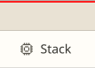
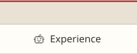
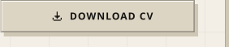
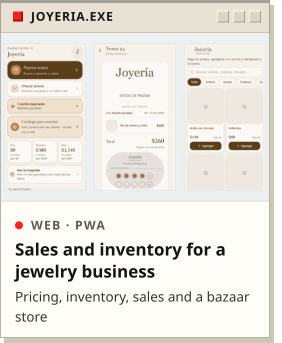
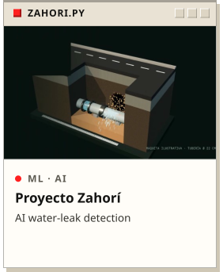
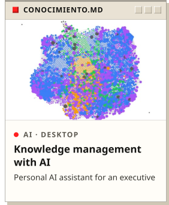

<!-- Generated by generador/generar.mjs from datos/perfil.en.json. Do not edit by hand. -->

<a href="README.es.md">Español</a>

<a href="https://www.kairomx.tech/cv/index.html?lang=en#inicio"><picture><source media="(max-width: 471px) and (prefers-color-scheme: dark)" srcset="assets/en-tab-home-mob-dark-d36dac0a.svg" width="33.3333%"><source media="(max-width: 471px)" srcset="assets/en-tab-home-mob-light-0477e33d.svg" width="33.3333%"><source media="(max-width: 1211px) and (prefers-color-scheme: dark)" srcset="assets/en-tab-home-tab-dark-f8c3d502.svg" width="12.8842%"><source media="(max-width: 1211px)" srcset="assets/en-tab-home-tab-light-afdffdfb.svg" width="12.8842%"><source media="(prefers-color-scheme: dark)" srcset="assets/en-tab-home-desk-dark-47198505.svg" width="12.8842%"></picture></a><a href="https://www.kairomx.tech/cv/index.html?lang=en#proyectos"><picture><source media="(max-width: 471px) and (prefers-color-scheme: dark)" srcset="assets/en-tab-projects-mob-dark-4652a8f5.svg" width="33.3333%"><source media="(max-width: 471px)" srcset="assets/en-tab-projects-mob-light-ac9de83c.svg" width="33.3333%"><source media="(max-width: 1211px) and (prefers-color-scheme: dark)" srcset="assets/en-tab-projects-tab-dark-04df9161.svg" width="17.4941%"><source media="(max-width: 1211px)" srcset="assets/en-tab-projects-tab-light-7916f662.svg" width="17.4941%"><source media="(prefers-color-scheme: dark)" srcset="assets/en-tab-projects-desk-dark-8fb0775b.svg" width="17.4941%"></picture></a><a href="https://www.kairomx.tech/cv/index.html?lang=en#stack"><picture><source media="(max-width: 471px) and (prefers-color-scheme: dark)" srcset="assets/en-tab-stack-mob-dark-05128012.svg" width="33.3333%"><source media="(max-width: 471px)" srcset="assets/en-tab-stack-mob-light-7099d7cb.svg" width="33.3333%"><source media="(max-width: 1211px) and (prefers-color-scheme: dark)" srcset="assets/en-tab-stack-tab-dark-023ade3b.svg" width="12.6478%"><source media="(max-width: 1211px)" srcset="assets/en-tab-stack-tab-light-20f3022a.svg" width="12.6478%"><source media="(prefers-color-scheme: dark)" srcset="assets/en-tab-stack-desk-dark-9a88505e.svg" width="12.6478%"></picture></a><a href="https://www.kairomx.tech/cv/index.html?lang=en#entrenamiento-ia"><picture><source media="(max-width: 471px) and (prefers-color-scheme: dark)" srcset="assets/en-tab-experience-mob-dark-eeceac46.svg" width="33.3333%"><source media="(max-width: 471px)" srcset="assets/en-tab-experience-mob-light-e6212e50.svg" width="33.3333%"><source media="(max-width: 1211px) and (prefers-color-scheme: dark)" srcset="assets/en-tab-experience-tab-dark-1ad1133f.svg" width="22.9314%"><source media="(max-width: 1211px)" srcset="assets/en-tab-experience-tab-light-56f7f047.svg" width="22.9314%"><source media="(prefers-color-scheme: dark)" srcset="assets/en-tab-experience-desk-dark-1f6faac6.svg" width="22.9314%"></picture></a><a href="https://www.kairomx.tech/cv/index.html?lang=en#sobre-mi"><picture><source media="(max-width: 471px) and (prefers-color-scheme: dark)" srcset="assets/en-tab-about-mob-dark-2869224b.svg" width="33.3333%"><source media="(max-width: 471px)" srcset="assets/en-tab-about-mob-light-dbbc04fb.svg" width="33.3333%"><source media="(max-width: 1211px) and (prefers-color-scheme: dark)" srcset="assets/en-tab-about-tab-dark-8e3b95ed.svg" width="13.2388%"><source media="(max-width: 1211px)" srcset="assets/en-tab-about-tab-light-0ac6016b.svg" width="13.2388%"><source media="(prefers-color-scheme: dark)" srcset="assets/en-tab-about-desk-dark-bc271e2a.svg" width="13.2388%"></picture></a><a href="https://www.kairomx.tech/cv/index.html?lang=en#contacto"><picture><source media="(max-width: 471px) and (prefers-color-scheme: dark)" srcset="assets/en-tab-contact-mob-dark-fc1c9466.svg" width="33.3333%"><source media="(max-width: 471px)" srcset="assets/en-tab-contact-mob-light-3a217225.svg" width="33.3333%"><source media="(max-width: 1211px) and (prefers-color-scheme: dark)" srcset="assets/en-tab-contact-tab-dark-9b6c1d69.svg" width="20.8038%"><source media="(max-width: 1211px)" srcset="assets/en-tab-contact-tab-light-3d357cc5.svg" width="20.8038%"><source media="(prefers-color-scheme: dark)" srcset="assets/en-tab-contact-desk-dark-61fe9890.svg" width="20.8038%"></picture></a> <a href="https://www.kairomx.tech/cv/index.html?lang=en"><picture><source media="(max-width: 471px) and (prefers-color-scheme: dark) and (prefers-reduced-motion: reduce)" srcset="assets/en-hero-mob-dark-still-ec235459.svg" width="100.0000%"><source media="(max-width: 471px) and (prefers-color-scheme: dark)" srcset="assets/en-hero-mob-dark-d098da50.svg" width="100.0000%"><source media="(max-width: 471px) and (prefers-reduced-motion: reduce)" srcset="assets/en-hero-mob-light-still-9a342a25.svg" width="100.0000%"><source media="(max-width: 471px)" srcset="assets/en-hero-mob-light-c007ff62.svg" width="100.0000%"><source media="(max-width: 1211px) and (prefers-color-scheme: dark) and (prefers-reduced-motion: reduce)" srcset="assets/en-hero-tab-dark-still-d1c6ad5a.svg" width="100.0000%"><source media="(max-width: 1211px) and (prefers-color-scheme: dark)" srcset="assets/en-hero-tab-dark-6922ef29.svg" width="100.0000%"><source media="(max-width: 1211px) and (prefers-reduced-motion: reduce)" srcset="assets/en-hero-tab-light-still-6b48ef7c.svg" width="100.0000%"><source media="(max-width: 1211px)" srcset="assets/en-hero-tab-light-b442d539.svg" width="100.0000%"><source media="(prefers-color-scheme: dark) and (prefers-reduced-motion: reduce)" srcset="assets/en-hero-desk-dark-still-839c05d8.svg" width="100.0000%"><source media="(prefers-color-scheme: dark)" srcset="assets/en-hero-desk-dark-1ed02830.svg" width="100.0000%"><source media="(prefers-reduced-motion: reduce)" srcset="assets/en-hero-desk-light-still-b04b11e2.svg" width="100.0000%"></picture></a> <a href="https://www.kairomx.tech/cv/index.html?lang=en#proyectos"><picture><source media="(max-width: 471px) and (prefers-color-scheme: dark)" srcset="assets/en-btn-projects-mob-dark-fd7c5889.svg" width="33.3333%"><source media="(max-width: 471px)" srcset="assets/en-btn-projects-mob-light-c9300c2c.svg" width="33.3333%"><source media="(max-width: 1211px) and (prefers-color-scheme: dark)" srcset="assets/en-btn-projects-tab-dark-0384dbcb.svg" width="33.3333%"><source media="(max-width: 1211px)" srcset="assets/en-btn-projects-tab-light-9ddce6af.svg" width="33.3333%"><source media="(prefers-color-scheme: dark)" srcset="assets/en-btn-projects-desk-dark-65d63ba5.svg" width="33.3333%"></picture></a><a href="https://www.kairomx.tech/cv/index.html?lang=en#contacto"><picture><source media="(max-width: 471px) and (prefers-color-scheme: dark)" srcset="assets/en-btn-contact-mob-dark-9b9bed05.svg" width="33.3333%"><source media="(max-width: 471px)" srcset="assets/en-btn-contact-mob-light-e63e6ef8.svg" width="33.3333%"><source media="(max-width: 1211px) and (prefers-color-scheme: dark)" srcset="assets/en-btn-contact-tab-dark-dccfef8f.svg" width="33.3333%"><source media="(max-width: 1211px)" srcset="assets/en-btn-contact-tab-light-f47747f4.svg" width="33.3333%"><source media="(prefers-color-scheme: dark)" srcset="assets/en-btn-contact-desk-dark-96644cd5.svg" width="33.3333%"></picture></a><a href="https://www.kairomx.tech/cv/pdf/cv-en.pdf"><picture><source media="(max-width: 471px) and (prefers-color-scheme: dark)" srcset="assets/en-btn-cv-mob-dark-bf3152aa.svg" width="33.3333%"><source media="(max-width: 471px)" srcset="assets/en-btn-cv-mob-light-757613e5.svg" width="33.3333%"><source media="(max-width: 1211px) and (prefers-color-scheme: dark)" srcset="assets/en-btn-cv-tab-dark-1261341f.svg" width="33.3333%"><source media="(max-width: 1211px)" srcset="assets/en-btn-cv-tab-light-6e0b759e.svg" width="33.3333%"><source media="(prefers-color-scheme: dark)" srcset="assets/en-btn-cv-desk-dark-cc872423.svg" width="33.3333%"></picture></a> <a href="https://www.kairomx.tech/cv/index.html?lang=en#contacto"><picture><source media="(max-width: 471px) and (prefers-color-scheme: dark) and (prefers-reduced-motion: reduce)" srcset="assets/en-status-mob-dark-still-d00478a8.svg" width="100.0000%"><source media="(max-width: 471px) and (prefers-color-scheme: dark)" srcset="assets/en-status-mob-dark-11336db5.svg" width="100.0000%"><source media="(max-width: 471px) and (prefers-reduced-motion: reduce)" srcset="assets/en-status-mob-light-still-7f630bc6.svg" width="100.0000%"><source media="(max-width: 471px)" srcset="assets/en-status-mob-light-a600ae3c.svg" width="100.0000%"><source media="(max-width: 1211px) and (prefers-color-scheme: dark) and (prefers-reduced-motion: reduce)" srcset="assets/en-status-tab-dark-still-8fa4bf2c.svg" width="100.0000%"><source media="(max-width: 1211px) and (prefers-color-scheme: dark)" srcset="assets/en-status-tab-dark-5f3b15c6.svg" width="100.0000%"><source media="(max-width: 1211px) and (prefers-reduced-motion: reduce)" srcset="assets/en-status-tab-light-still-8687de3d.svg" width="100.0000%"><source media="(max-width: 1211px)" srcset="assets/en-status-tab-light-dd4f0e5d.svg" width="100.0000%"><source media="(prefers-color-scheme: dark) and (prefers-reduced-motion: reduce)" srcset="assets/en-status-desk-dark-still-bf60218d.svg" width="100.0000%"><source media="(prefers-color-scheme: dark)" srcset="assets/en-status-desk-dark-3e7c3e9c.svg" width="100.0000%"><source media="(prefers-reduced-motion: reduce)" srcset="assets/en-status-desk-light-still-2aa1c6f2.svg" width="100.0000%"></picture></a>

<a href="https://www.kairomx.tech/cv/index.html?lang=en#stack"><picture><source media="(max-width: 471px) and (prefers-color-scheme: dark)" srcset="assets/en-stack-mob-dark-9317e52c.svg" width="100.0000%"><source media="(max-width: 471px)" srcset="assets/en-stack-mob-light-e8bde0fe.svg" width="100.0000%"><source media="(max-width: 1211px) and (prefers-color-scheme: dark)" srcset="assets/en-stack-tab-dark-10e17074.svg" width="100.0000%"><source media="(max-width: 1211px)" srcset="assets/en-stack-tab-light-02d6f91e.svg" width="100.0000%"><source media="(prefers-color-scheme: dark)" srcset="assets/en-stack-desk-dark-edbcb0e7.svg" width="100.0000%"></picture></a>

<a href="https://www.kairomx.tech/cv/proyectos/joyeria.html?lang=en"><picture><source media="(max-width: 471px) and (prefers-color-scheme: dark)" srcset="assets/en-proj-joyeria-mob-dark-7bfbf302.svg" width="100.0000%"><source media="(max-width: 471px)" srcset="assets/en-proj-joyeria-mob-light-f8b57e4d.svg" width="100.0000%"><source media="(max-width: 1211px) and (prefers-color-scheme: dark)" srcset="assets/en-proj-joyeria-tab-dark-2225bc42.svg" width="33.3333%"><source media="(max-width: 1211px)" srcset="assets/en-proj-joyeria-tab-light-d9311ef3.svg" width="33.3333%"><source media="(prefers-color-scheme: dark)" srcset="assets/en-proj-joyeria-desk-dark-fdfd142e.svg" width="33.3333%"></picture></a><a href="https://www.kairomx.tech/cv/proyectos/zahori.html?lang=en"><picture><source media="(max-width: 471px) and (prefers-color-scheme: dark)" srcset="assets/en-proj-zahori-mob-dark-0a0c2d04.svg" width="100.0000%"><source media="(max-width: 471px)" srcset="assets/en-proj-zahori-mob-light-4c014ad3.svg" width="100.0000%"><source media="(max-width: 1211px) and (prefers-color-scheme: dark)" srcset="assets/en-proj-zahori-tab-dark-24a79d32.svg" width="33.3333%"><source media="(max-width: 1211px)" srcset="assets/en-proj-zahori-tab-light-a142e9c4.svg" width="33.3333%"><source media="(prefers-color-scheme: dark)" srcset="assets/en-proj-zahori-desk-dark-45c236b8.svg" width="33.3333%"></picture></a><a href="https://www.kairomx.tech/cv/proyectos/conocimiento.html?lang=en"><picture><source media="(max-width: 471px) and (prefers-color-scheme: dark)" srcset="assets/en-proj-conocimiento-mob-dark-9e46e622.svg" width="100.0000%"><source media="(max-width: 471px)" srcset="assets/en-proj-conocimiento-mob-light-48775a10.svg" width="100.0000%"><source media="(max-width: 1211px) and (prefers-color-scheme: dark)" srcset="assets/en-proj-conocimiento-tab-dark-381d4ab6.svg" width="33.3333%"><source media="(max-width: 1211px)" srcset="assets/en-proj-conocimiento-tab-light-08a9070c.svg" width="33.3333%"><source media="(prefers-color-scheme: dark)" srcset="assets/en-proj-conocimiento-desk-dark-e38295b5.svg" width="33.3333%"></picture></a>

