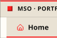
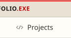
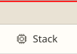
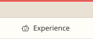
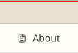
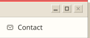
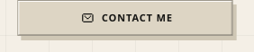
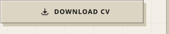

<!-- Generated by generador/generar.mjs from datos/perfil.en.json. Do not edit by hand. -->

<a href="https://www.kairomx.tech/cv/index.html?lang=en#inicio"><picture><source media="(max-width: 767px) and (prefers-color-scheme: dark)" srcset="assets/tab-home-mob-dark-98fb9bd7.svg"><source media="(max-width: 767px)" srcset="assets/tab-home-mob-light-765c2a32.svg"><source media="(prefers-color-scheme: dark)" srcset="assets/tab-home-desk-dark-fb8ccbc2.svg"></picture></a><a href="https://www.kairomx.tech/cv/index.html?lang=en#proyectos"><picture><source media="(max-width: 767px) and (prefers-color-scheme: dark)" srcset="assets/tab-projects-mob-dark-a00d878c.svg"><source media="(max-width: 767px)" srcset="assets/tab-projects-mob-light-e95e493c.svg"><source media="(prefers-color-scheme: dark)" srcset="assets/tab-projects-desk-dark-ad114a71.svg"></picture></a><a href="https://www.kairomx.tech/cv/index.html?lang=en#stack"><picture><source media="(max-width: 767px) and (prefers-color-scheme: dark)" srcset="assets/tab-stack-mob-dark-7b32c684.svg"><source media="(max-width: 767px)" srcset="assets/tab-stack-mob-light-c89cf02b.svg"><source media="(prefers-color-scheme: dark)" srcset="assets/tab-stack-desk-dark-05524be0.svg"></picture></a><a href="https://www.kairomx.tech/cv/index.html?lang=en#entrenamiento-ia"><picture><source media="(max-width: 767px) and (prefers-color-scheme: dark)" srcset="assets/tab-experience-mob-dark-11b38c59.svg"><source media="(max-width: 767px)" srcset="assets/tab-experience-mob-light-701eab62.svg"><source media="(prefers-color-scheme: dark)" srcset="assets/tab-experience-desk-dark-be8c55ba.svg"></picture></a><a href="https://www.kairomx.tech/cv/index.html?lang=en#sobre-mi"><picture><source media="(max-width: 767px) and (prefers-color-scheme: dark)" srcset="assets/tab-about-mob-dark-28191dfd.svg"><source media="(max-width: 767px)" srcset="assets/tab-about-mob-light-7d45385e.svg"><source media="(prefers-color-scheme: dark)" srcset="assets/tab-about-desk-dark-3139b304.svg"></picture></a><a href="https://www.kairomx.tech/cv/index.html?lang=en#contacto"><picture><source media="(max-width: 767px) and (prefers-color-scheme: dark)" srcset="assets/tab-contact-mob-dark-99d7c2e2.svg"><source media="(max-width: 767px)" srcset="assets/tab-contact-mob-light-f287a13f.svg"><source media="(prefers-color-scheme: dark)" srcset="assets/tab-contact-desk-dark-c238b503.svg"></picture></a> <a href="https://www.kairomx.tech/cv/index.html?lang=en"><picture><source media="(max-width: 767px) and (prefers-color-scheme: dark) and (prefers-reduced-motion: reduce)" srcset="assets/hero-mob-dark-still-60944461.svg"><source media="(max-width: 767px) and (prefers-color-scheme: dark)" srcset="assets/hero-mob-dark-def9664c.svg"><source media="(max-width: 767px) and (prefers-reduced-motion: reduce)" srcset="assets/hero-mob-light-still-b4ccd277.svg"><source media="(max-width: 767px)" srcset="assets/hero-mob-light-3d0f7997.svg"><source media="(prefers-color-scheme: dark) and (prefers-reduced-motion: reduce)" srcset="assets/hero-desk-dark-still-c0e91bf3.svg"><source media="(prefers-color-scheme: dark)" srcset="assets/hero-desk-dark-b5732136.svg"><source media="(prefers-reduced-motion: reduce)" srcset="assets/hero-desk-light-still-6e76f144.svg"></picture></a> <a href="https://www.kairomx.tech/cv/index.html?lang=en#proyectos"><picture><source media="(max-width: 767px) and (prefers-color-scheme: dark)" srcset="assets/btn-projects-mob-dark-ad2a2ab0.svg"><source media="(max-width: 767px)" srcset="assets/btn-projects-mob-light-fec83850.svg"><source media="(prefers-color-scheme: dark)" srcset="assets/btn-projects-desk-dark-297a686e.svg"></picture></a><a href="https://www.kairomx.tech/cv/index.html?lang=en#contacto"><picture><source media="(max-width: 767px) and (prefers-color-scheme: dark)" srcset="assets/btn-contact-mob-dark-44933ca8.svg"><source media="(max-width: 767px)" srcset="assets/btn-contact-mob-light-70d9d394.svg"><source media="(prefers-color-scheme: dark)" srcset="assets/btn-contact-desk-dark-2269925f.svg"></picture></a><a href="https://www.kairomx.tech/cv/pdf/cv-en.pdf"><picture><source media="(max-width: 767px) and (prefers-color-scheme: dark)" srcset="assets/btn-cv-mob-dark-60d9fde8.svg"><source media="(max-width: 767px)" srcset="assets/btn-cv-mob-light-b362f36f.svg"><source media="(prefers-color-scheme: dark)" srcset="assets/btn-cv-desk-dark-3ef754ee.svg"></picture></a> <a href="https://www.kairomx.tech/cv/index.html?lang=en#contacto"><picture><source media="(max-width: 767px) and (prefers-color-scheme: dark) and (prefers-reduced-motion: reduce)" srcset="assets/status-mob-dark-still-2959a09d.svg"><source media="(max-width: 767px) and (prefers-color-scheme: dark)" srcset="assets/status-mob-dark-f70cd7ac.svg"><source media="(max-width: 767px) and (prefers-reduced-motion: reduce)" srcset="assets/status-mob-light-still-514b59d3.svg"><source media="(max-width: 767px)" srcset="assets/status-mob-light-790fbdc1.svg"><source media="(prefers-color-scheme: dark) and (prefers-reduced-motion: reduce)" srcset="assets/status-desk-dark-still-bf60218d.svg"><source media="(prefers-color-scheme: dark)" srcset="assets/status-desk-dark-3e7c3e9c.svg"><source media="(prefers-reduced-motion: reduce)" srcset="assets/status-desk-light-still-2aa1c6f2.svg"></picture></a>

